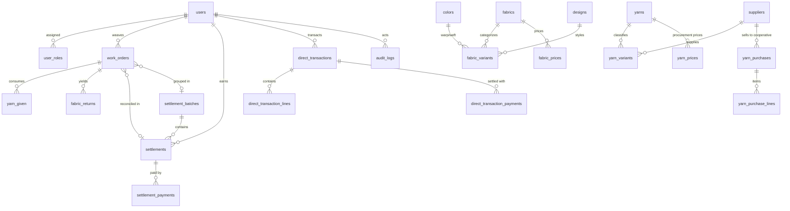
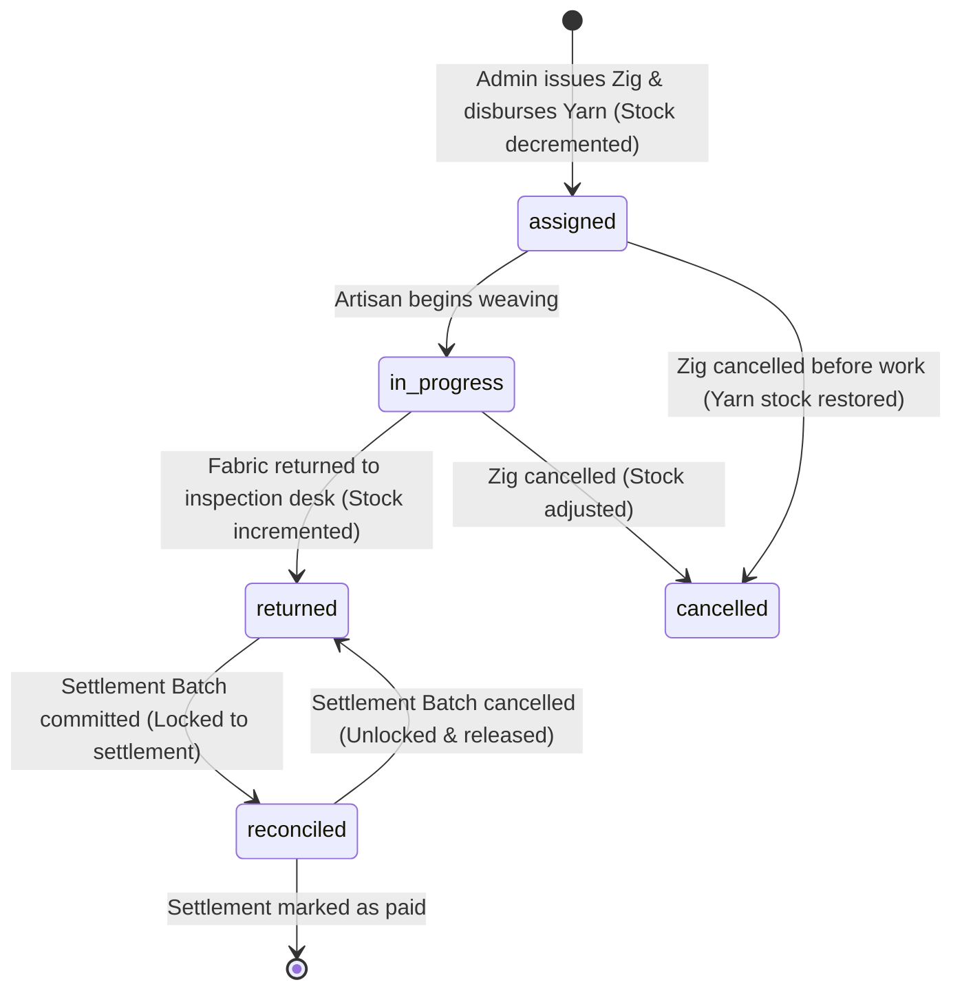

# Software Requirements Specification (SRS)
## Awra Amba Textile Cooperative Management Information System (MIS)

**Document Version:** 2.1.0  
**Status:** Approved & Implemented  
**Date:** November 2026  
**Authors:** Awra Amba Software Development Team & Systems Architecture Group  
**Target Audience:** Core Developers, System Administrators, QA Engineers, Cooperative Management  

---

## Table of Contents
1. [Introduction](#1-introduction)
   - 1.1 Purpose
   - 1.2 System Scope & Background
   - 1.3 Amharic & Technical Glossary
   - 1.4 References
2. [Overall System Architecture & Design Philosophy](#2-overall-system-architecture--design-philosophy)
   - 2.1 Clean Architecture Model
   - 2.2 Technology Stack
   - 2.3 User Personas & Permissions Overview
   - 2.4 Core Design Constraints & Invariants
3. [Security & Access Control Specification (RBAC & ABAC)](#3-security--access-control-specification-rbac--abac)
   - 3.1 Authentication & Credential Management
   - 3.2 Fine-Grained Capabilities
   - 3.3 Attribute-Based Access Control (ABAC) & Data Masking
4. [Comprehensive Data Model & Schema Specification](#4-comprehensive-data-model--schema-specification)
   - 4.1 Database Architecture & Schema Diagram
   - 4.2 Enums & Data Types
   - 4.3 Detailed Entity Specifications
5. [Detailed Functional Requirements & Domain Workflows](#5-detailed-functional-requirements--domain-workflows)
   - 5.1 Work Order (Zig - ዝግ) Lifecycle & Production Engine
   - 5.2 Quality Tolerance & Deductions Calculation
   - 5.3 Batch Settlement & Weaver Payroll Engine
   - 5.4 Official HISAB Statements & Amharic Words Conversion
   - 5.5 Commercial Hub & Direct Transactions
   - 5.6 Master Catalog, Pricing Schedules & Stock Management
   - 5.7 Weaver Web-First Portal
   - 5.8 Merchant Wholesale Catalog Portal
   - 5.9 Audit Trail & Immutable Logging
   - 5.10 Financial Reporting, Executive Analytics & Data Integrity
6. [API Specification & Controller Mapping](#6-api-specification--controller-mapping)
7. [Frontend Architecture & Tokenized Design System](#7-frontend-architecture--tokenized-design-system)
   - 7.1 Architecture & State Flow
   - 7.2 Explicit CSS Cascade Layering
   - 7.3 Responsive Design Standards
8. [Non-Functional Requirements](#8-non-functional-requirements)
   - 8.1 Transactional Atomicity & Data Consistency
   - 8.2 Precision & Rounding Rules
   - 8.3 Security & Tamper Resistance
   - 8.4 Maintainability & Extensibility

---

## 1. Introduction

### 1.1 Purpose
This document provides a comprehensive Software Requirements Specification (SRS) for the **Awra Amba Textile Management Information System (MIS)**. It defines the complete functional and technical blueprint of the application, encompassing the domain rules, database architecture, security controls, API interfaces, frontend components, and mathematical formulations. It serves as the authoritative guide for onboarding, ongoing maintenance, and future feature extensions.

### 1.2 System Scope & Background
Awra Amba is an intentional community in the Amhara Region of Ethiopia celebrated globally for gender equality, collective labor, and artisan textile manufacturing. Traditional operations relied on manual paper ledgers, desktop scripts, and spreadsheets (`albasat_zigs.xlsx`, `Hisab-5` statements).

This web-based MIS digitizes and unifies the end-to-end cooperative textile workflow:
1. Raw yarn procurement from commercial suppliers.
2. Yarn disbursement to individual artisans for weaving work orders (**Zigs**).
3. Inspection and return of woven fabrics with weight tolerance quality checks.
4. Transparent, automated batch payroll settlements (**HISAB**) with printed statements in Amharic.
5. Direct commercial sales to wholesale merchants and local buyers.
6. Real-time stock snapshot tracking across all multi-variant fabrics and raw yarns.

### 1.3 Amharic & Technical Glossary

| Term (English / Amharic) | Meaning & Context in System |
|---|---|
| **Zig (ዝግ)** | A production work order assigned to a specific artisan weaver. Encapsulates yarn disbursed, fabric returned, quality inspection, and net wage settlement. |
| **Hisab (ሂሳብ)** | Official settlement statement, payroll reconciliation, or commercial transaction receipt. |
| **Shemane (ሸማኔ)** | Cooperative artisan weaver responsible for transforming yarn into woven textiles. |
| **Temen (ተመን)** | Cooperative-mandated piece-rate wage paid to the weaver per successfully woven fabric piece. |
| **Warp (ዋርፍ)** | Longitudinal threads held in tension on a loom. |
| **Weft (ሸፋ)** | Transverse threads woven across the warp threads. |
| **Biret (ብረት)** | Traditional iron-gray color shade frequently used in Awra Amba fabrics. |
| **Medebegna (መደበኛ)** | Standard everyday cooperative fabric style. |
| **Gabi (ጋቢ)** | Thick, warm 4-layer traditional Ethiopian blanket. |
| **Netela (ነጠላ)** | Lightweight, delicate traditional scarf/shawl with decorative borders. |
| **Tibeb (ጥበብ)** | Intricate decorative woven borders or patterns. |
| **Geberdin (ገበርዲን)** | Diagonal twill weave pattern known for durability. |
| **Stock Snapshot** | Real-time recorded balance in inventory (`stock_snapshot` in DB; tracked in pieces for both yarn and fabric). |
| **WIP (Work in Progress)** | Fabric currently being woven by weavers on assigned zigs that has not yet been inspected or returned. |

### 1.4 References
- `docs/planned-business-and-database-update.md` — Domain design baseline and settlement overhaul.
- `docs/system-integration-and-page-audit.md` — Route-by-route integration matrix and audit logs.
- `backend/prisma/schema.prisma` — Authoritative PostgreSQL database schema.
- IEEE Std 830-1998 — Recommended Practice for Software Requirements Specifications.

---

## 2. Overall System Architecture & Design Philosophy

### 2.1 Clean Architecture Model
The system strictly enforces **Clean Architecture** with inward-pointing dependencies:

```
[ Presentation Layer: Express Routes / Controllers / React Pages ]
                            ↓
[ Application Services: Workflow Orchestration & Calculation Services ]
                            ↓
[ Domain Layer: Business Invariants, ABAC/RBAC Rules, Security Entities ]
                            ↑
[ Infrastructure Layer: Prisma Client / PostgreSQL / HTTP Client / Storage ]
```

- **Domain Layer:** Pure business rules, calculation invariants, and security policies. Contains no dependencies on databases or UI frameworks.
- **Application Services:** Use-case orchestrators (e.g., `SettlementService`, `WorkOrderService`, `DirectTransactionService`, `CalculationService`) that manage database transactions and enforce business invariants.
- **Infrastructure Layer:** Prisma ORM, Argon2 password hashing, JWT token services, and frontend API client facades.
- **Presentation Layer:** Express controllers for the backend API; React components, custom hooks, and tokenized CSS layers for the client.

### 2.2 Technology Stack
- **Backend:** Node.js (ES Modules), TypeScript, Express.js.
- **Database & ORM:** PostgreSQL 15+, Prisma ORM (`@prisma/client`).
- **Security:** Argon2 for password hashing, JSON Web Tokens (`jsonwebtoken`) for stateless session authorization.
- **Testing:** Vitest with automated unit, integration, and security rule suites.
- **Frontend:** React 19, TypeScript, Vite, React Router v7.
- **Styling Architecture:** Plain CSS organized into explicit CSS Cascade Layers (`@layer reset, tokens, base, layout, components, utilities, pages`) with design tokens. Zero CSS runtime overhead.

### 2.3 User Personas & Permissions Overview

```mermaid
flowchart TD
    Guest["Public / Guest"] --> Browse["Browse Catalog & Pricing"]
    Guest --> Auth["Sign In / Self-Register"]
    
    Weaver["Weaver"] --> WPortal["Weaver Portal"]
    WPortal --> WZigs["Inspect Assigned Zigs"]
    WPortal --> WPay["Download HISAB Receipts"]
    WPortal --> WRates["View Piece Rates"]
    WPortal --> WCalc["Simulate Earnings"]
    
    Merchant["Commercial Merchant"] --> MPortal["Merchant Portal"]
    MPortal --> MCatalog["Faceted Fabric Catalog & Pricing"]
    MPortal --> MTxns["View Commercial Purchases"]
    
    Admin["System Administrator / Staff"] --> AdminHub["Admin Console"]
    AdminHub --> AProd["Issue & Reconcile Zigs"]
    AdminHub --> ASettle["Run Batch Settlements"]
    AdminHub --> ATrans["Commercial Sales & Procurement"]
    AdminHub --> ACatalog["Manage Catalog & Prices"]
    AdminHub --> AUsers["User Administration"]
    AdminHub --> AAudit["Tamper-Evident Audit Log"]
```



### 2.4 Core Design Constraints & Invariants
1. **Deterministic Automated Identification:** All SKU identifiers for catalog variants (fabric and yarn) are deterministically auto-generated by the system from immutable domain attributes. User interfaces must never provide manual or arbitrary SKU text input fields.
2. **Zero-Mock & Zero-Guess Data Invariant:** User interface components, state management hooks, and report dashboards must never use hardcoded mock objects (`DEFAULT_*`, `INITIAL_*`) or guessed fallback numbers (e.g. static currency estimates). If no database records exist, systems must render authentic empty states.
3. **Traceable Financial Accounting:** Every reported revenue and expense metric must be directly derived from completed transactions (`direct_transactions`, `settlements`, `yarn_purchases`). No synthetic or decoupled financial state is permitted.
4. **Data Contract Symmetry:** API responses across public, merchant, and admin surfaces must adhere to canonical DTO contracts. Flattened projections must map both flat and relational structures without dropping pricing or metadata attributes.

---

## 3. Security & Access Control Specification (RBAC & ABAC)

### 3.1 Authentication & Credential Management
1. **User Identity:** Each user possesses an immutable `userId`, unique `username`, `firstName` (required), optional `lastName`, optional `phone`, and hashed password.
2. **Password Hashing:** Passwords are never stored in plaintext. They are hashed using `argon2id` with cryptographically secure salts.
3. **Session Tokens:** Upon login, an authenticated JWT is issued containing:
   - `sub`: `userId`
   - `username`: Username string
   - `roles`: Array of assigned roles (`["admin"]`, `["weaver"]`, `["merchant"]`)
4. **Profile Management & Portal Switching:** All portals expose a consistent top-right `AccountMenu` allowing users to update their own `firstName`, `lastName`, `username`, and `phone` (`PATCH /api/v1/auth/me`), change their password (`POST /api/v1/auth/change-password`), switch between portals when assigned multiple roles, and sign out.
5. **Session Lifetime:** Bearer tokens expire in 24 hours. Sign-out clears client storage and navigates the user back to the public landing page (`/`).

### 3.2 Fine-Grained Capabilities
Access to backend endpoints is protected by capability guards rather than raw role checks. Capabilities map to roles via `RbacService`:

| Capability Identifier | Description | Admin | Weaver | Merchant |
|---|---|:---:|:---:|:---:|
| `users.read` | View user profiles and balances | Yes | Own | Own |
| `users.manage` | Create users, deactivate accounts, reset passwords | Yes | No | No |
| `roles.manage` | Assign or revoke roles | Yes | No | No |
| `work_orders.read_all` | View all cooperative work orders | Yes | No | No |
| `work_orders.read_own` | View artisan's own work orders | Yes | Yes | No |
| `work_orders.manage` | Issue zigs, cancel zigs, update statuses | Yes | No | No |
| `yarn_given.manage` | Disburse yarn, edit/delete yarn disbursements | Yes | No | No |
| `fabric_returns.manage` | Record, edit, or delete woven fabric returns | Yes | No | No |
| `settlements.read_all` | View all settlement batches and history | Yes | No | No |
| `settlements.read_own` | View own settled statements and receipts | Yes | Yes | No |
| `settlements.manage` | Preview, commit, pay, or cancel settlement runs | Yes | No | No |
| `direct_transactions.read_all` | View enterprise commercial transaction hub | Yes | No | No |
| `direct_transactions.read_own` | View own sales or purchase orders | Yes | Yes | Yes |
| `direct_transactions.manage` | Create, pay, or cancel commercial transactions | Yes | No | No |
| `procurement.manage` | Procure raw yarn from suppliers | Yes | No | No |
| `catalog.read` | Browse active fabrics, yarns, and public prices | Yes | Yes | Yes |
| `catalog.manage` | Add or update fabrics, designs, colors, suppliers | Yes | No | No |
| `prices.manage` | Configure weaver piece rates and selling prices | Yes | No | No |
| `quality_rules.manage` | Update weight tolerance deduction rules | Yes | No | No |
| `stock.read` | View inventory balances and stock snapshots | Yes | No | No |
| `reports.read_financial` | View financial summaries, margins, and HISAB | Yes | No | No |
| `audit.read` | Read system activity log | Yes | No | No |

### 3.3 Attribute-Based Access Control (ABAC) & Data Masking
To preserve cooperative financial confidentiality:
1. **Merchant Masking:** When a user with the `merchant` role calls `GET /catalog/fabric-prices` or views catalog variants, `AbacService.maskForRole` sanitizes the records. The internal `weaverRate` (artisan wage) and raw procurement costs are stripped from the response.
2. **Weaver Scoping:** When an artisan queries work orders or settlements, queries are strictly scoped by `WHERE weaverUserId = req.user.userId`. Artisans cannot inspect peers' production data or gross commercial margins.

---

## 4. Comprehensive Data Model & Schema Specification

### 4.1 Database Architecture & Schema Diagram



### 4.2 Enums & Data Types

| Enum Name | Allowed Values | Description |
|---|---|---|
| `UserRole` | `admin`, `weaver`, `merchant` | Primary system security roles. |
| `WorkOrderStatus` | `assigned`, `in_progress`, `returned`, `reconciled`, `cancelled` | Zig lifecycle stages. |
| `SettlementStatus` | `draft`, `committed`, `paid`, `cancelled` | Individual weaver settlement status. |
| `SettlementBatchStatus` | `draft`, `committed`, `paid`, `cancelled` | Batch settlement run lifecycle. |
| `DirectTxnType` | `fabric_purchase_from_weaver`, `yarn_sale_to_weaver`, `fabric_sale_to_merchant` | Commercial transaction types. |
| `DirectTxnStatus` | `unpaid`, `partially_paid`, `paid`, `cancelled` | Commercial invoice payment status. |

### 4.3 Detailed Entity Specifications

#### 1. Users & Security
- `users`: `userId` (PK, int, auto), `username` (unique, varchar 60), `firstName` (varchar 60, required), `lastName` (varchar 60, nullable), `phone` (varchar 30), `email` (varchar 120), `passwordHash` (varchar 200), `isActive` (bool, default true), `createdAt`, `updatedAt`.
- `user_roles`: `userId` (FK), `role` (`UserRole`). Composite PK: `(userId, role)`.

#### 2. Master Catalog
- `fabrics`: `fabricId` (PK), `name` (unique, varchar 120), `standardLengthCm` (decimal 10,2), `standardWidthCm` (decimal 10,2), `standardWeightG` (decimal 10,2), `isActive` (bool).
- `colors`: `colorId` (PK), `name` (unique, varchar 80).
- `designs`: `designId` (PK), `name` (unique, varchar 120).
- `suppliers`: `supplierId` (PK), `name` (unique, varchar 120), `contactPhone` (varchar 30), `isActive` (bool).
- `yarns`: `yarnId` (PK), `name` (unique, varchar 80), `isActive` (bool).
- `fabric_variants`: `fabricVariantId` (PK), `fabricId` (FK), `designId` (FK), `warpColorId` (FK), `weftColorId` (FK), `sku` (unique, varchar 40), `stockSnapshot` (decimal 12,2, default 0), `isActive` (bool).
- `yarn_variants`: `yarnVariantId` (PK), `yarnId` (FK), `colorId` (FK), `supplierId` (FK), `sku` (unique, varchar 40), `stockSnapshot` (decimal 12,2, default 0), `isActive` (bool).

#### 3. Pricing & Quality Rules
- `fabric_prices`: `fabricPriceId` (PK), `fabricId` (FK), `weaverRate` (decimal 12,2), `sellingPrice` (decimal 12,2), `effectiveFrom` (timestamp), `effectiveTo` (timestamp), `isActive` (bool).
- `yarn_prices`: `yarnPriceId` (PK), `yarnId` (FK), `supplierId` (FK), `purchasePrice` (decimal 12,2), `sellingPrice` (decimal 12,2), `effectiveFrom` (timestamp), `effectiveTo` (timestamp), `isActive` (bool).
- `quality_rules`: `qualityRuleId` (PK), `factor` (varchar 30, e.g. "weight"), `unit` (varchar 20, e.g. "g"), `deductionPerUnit` (decimal 10,2), `isActive` (bool).

#### 4. Production (Zigs)
- `work_orders`: `zigId` (PK, varchar 20), `weaverUserId` (FK), `fabricVariantId` (FK), `status` (`WorkOrderStatus`, default `assigned`), `dateIssued` (timestamp), `dateReturned` (timestamp), `issuedByUserId` (FK), `netPayable` (decimal 12,2), `settlementId` (FK, nullable), `settlementBatchId` (FK, nullable).
- `yarn_given`: `yarnGivenId` (PK), `zigId` (FK), `yarnVariantId` (FK), `quantity` (decimal 10,2, pieces), `unitPrice` (decimal 12,2), `dateGiven` (timestamp), `recordedByUserId` (FK), `remark` (text).
- `fabric_returns`: `returnId` (PK), `zigId` (FK), `fabricVariantId` (FK), `quantityReturned` (int), `totalWeight` (decimal 10,2, grams), `lengthCm` (decimal 10,2), `widthCm` (decimal 10,2), `unitPrice` (decimal 12,2), `grossFabricValue` (decimal 12,2), `deductionAmount` (decimal 12,2), `deductions` (Json), `dateReturned` (timestamp), `recordedByUserId` (FK), `remark` (text).

#### 5. Settlements & Payroll
- `settlement_batches`: `batchId` (PK), `status` (`SettlementBatchStatus`, default `committed`), `cutoffDate` (timestamp), `exceptionZigIds` (Json), `totalAmount` (decimal 14,2), `amountPaid` (decimal 14,2), `paymentMethod` (varchar 50), `notes` (text), `createdByUserId` (FK), `createdAt`, `committedAt`, `paidAt`.
- `settlements`: `settlementId` (PK), `batchId` (FK), `weaverUserId` (FK), `status` (`SettlementStatus`, default `draft`), `grossFabricValue` (decimal 12,2), `totalDeductions` (decimal 12,2), `totalYarnCost` (decimal 12,2), `netAmount` (decimal 12,2), `cancelReason` (text), `notes` (text), `createdByUserId` (FK), `createdAt`, `paidAt`.
- `settlement_payments`: `settlementPaymentId` (PK), `settlementId` (FK), `amount` (decimal 12,2), `paymentMethod` (varchar 30), `paymentDate` (timestamp), `recordedByUserId` (FK), `notes` (text).

#### 6. Commercial Transactions & Procurement
- `direct_transactions`: `transactionId` (PK), `type` (`DirectTxnType`), `weaverUserId` (FK, nullable), `merchantUserId` (FK, nullable), `totalAmount` (decimal 14,2), `amountPaid` (decimal 14,2), `status` (`DirectTxnStatus`), `transactionDate` (timestamp), `createdByUserId` (FK), `notes` (text).
- `direct_transaction_lines`: `lineId` (PK), `transactionId` (FK), `fabricVariantId` (FK, nullable), `yarnVariantId` (FK, nullable), `quantity` (decimal 10,2), `unitPrice` (decimal 12,2), `lineTotal` (decimal 12,2), `description` (varchar 200).
- `direct_transaction_payments`: `paymentId` (PK), `transactionId` (FK), `amount` (decimal 12,2), `paymentMethod` (varchar 30), `paymentDate` (timestamp), `recordedByUserId` (FK), `notes` (text).
- `yarn_purchases`: `purchaseId` (PK), `supplierId` (FK), `purchaseDate` (timestamp), `createdByUserId` (FK), `notes` (text).
- `yarn_purchase_lines`: `lineId` (PK), `purchaseId` (FK), `yarnVariantId` (FK), `quantity` (decimal 10,2), `unitPrice` (decimal 12,2).

#### 7. Audit Logging
- `audit_logs`: `auditLogId` (PK), `actorUserId` (FK), `action` (varchar 80), `entityType` (varchar 80), `entityId` (varchar 80), `details` (Json), `createdAt` (timestamp).

---

## 5. Detailed Functional Requirements & Domain Workflows

### 5.1 Work Order (Zig - ዝግ) Lifecycle & Production Engine



1. **Issuance:** An admin selects an active weaver and a fabric variant.
   - The system checks available yarn stock in `yarn_variants.stock_snapshot`.
   - If stock is insufficient, the transaction fails with `INSUFFICIENT_STOCK`.
   - On success, `work_orders` record is created, `yarn_given` lines are inserted, and `yarn_variants.stock_snapshot` is atomically decremented.
2. **Inspection & Returns:** Artisans deliver woven fabric pieces to the cooperative inspection desk.
   - Staff records pieces returned, total weight (grams), length, and width.
   - The quality deduction algorithm is applied per return (see §5.2).
   - `fabric_variants.stock_snapshot` is atomically incremented by pieces returned.
   - Work order status updates to `returned`.
3. **Locking & Immutability:** Once a work order is linked to a `settlementId`, it becomes strictly read-only. No further yarn disbursements or fabric return modifications are permitted unless the settlement run is formally cancelled.

### 5.2 Quality Tolerance & Deductions Calculation
Weavers are paid piece rates for meeting cooperative fabric specifications. Quality rules in `quality_rules` support arbitrary factors (`weight`, `length`, `width`, or custom factors) with configurable units (`g`, `cm`, etc.) and `deductionPerUnit`. Active rules are applied automatically by default on fabric returns (with the option to cancel/override per return), such as weight shortfall deductions:

$$\text{average\_weight} = \frac{\text{total\_weight\_grams}}{\text{quantity\_returned}}$$

$$\text{counted\_weight} = \lfloor \text{average\_weight} \rfloor$$

$$\text{grams\_short} = \max\left(0, \text{standard\_weight\_grams} - \text{counted\_weight}\right)$$

$$\text{deduction\_per\_piece} = \text{grams\_short} \times \text{deduction\_rate\_per\_gram}$$

$$\text{gross\_fabric\_value} = \text{quantity\_returned} \times \text{weaver\_piece\_rate}$$

$$\text{total\_deduction} = \text{deduction\_per\_piece} \times \text{quantity\_returned}$$

$$\text{net\_fabric\_value} = \text{gross\_fabric\_value} - \text{total\_deduction}$$

$$\text{zig\_net\_payable} = \text{net\_fabric\_value} - \text{total\_yarn\_cost}$$

*Rule Constraint:* If $\text{deduction\_per\_piece} > \text{weaver\_piece\_rate}$, the deduction is capped at the unit piece rate; a weaver's fabric line cannot produce a negative fabric credit prior to yarn deductions.

### 5.3 Batch Settlement & Weaver Payroll Engine
1. **Previewing Runs:** Admin specifies a `cutoffDate` (and optional extra zigs). The preview engine:
   - Queries all zigs with status `returned` where `settlementId IS NULL` and `dateReturned <= cutoffDate`.
   - Bundles work orders by `weaverUserId`.
   - Computes total fabric credit, total yarn charged, and net payable.
   - **Negative Balance Safeguard:** If any weaver's yarn cost exceeds their fabric credit ($\text{yarn\_cost} > \text{fabric\_credit}$), the weaver is flagged as **BLOCKED**. The admin is alerted with the exact defect and cannot commit the batch until the work order returns are corrected.
2. **Commitment:** When confirmed:
   - A `settlement_batches` row is created with status `committed`.
   - A `settlements` row is created for each weaver.
   - All included work orders have their `settlementId` and `settlementBatchId` populated and status updated to `reconciled`.
3. **Cancellation & Zig Release:** If an error is discovered post-commit (before any weaver is paid):
   - Admin triggers `POST /settlements/batches/:id/cancel` with a required audit reason.
   - In a single database transaction:
     - All associated work orders have `settlementId` and `settlementBatchId` reset to `NULL` and status reverted to `returned`.
     - Settlements and batch statuses are set to `cancelled`.
     - An immutable audit log entry is recorded.
     - Work orders are immediately available for re-inspection and future settlement runs.
4. **Disbursement (Payout):**
   - Admin marks the run as paid via cash or bank transfer.
   - `settlement_payments` are generated for each settlement.
   - Settlement and batch statuses transition to `paid`.

### 5.4 Official HISAB Statements & Amharic Words Conversion
Official settlement statements and payment receipts can be printed or exported to CSV (`/reports/hisab/:type/:id`).
- Statements render official headers, date stamps, detailed breakdown of all returned zigs, weights, deductions, and yarn costs.
- **Amharic Currency Words Engine:** Payout totals are converted into official Amharic words (e.g., `54,180 ETB` $\rightarrow$ *"ሃምሳ አራት ሺህ አንድ መቶ ሰማንያ ብር ከ 00/100"*), fulfilling legal and cooperative audit standards in Ethiopia.

### 5.5 Commercial Hub & Direct Transactions
The commercial engine manages wholesale sales, direct weaver sales, and supplier procurement:
1. **Fabric Sales to Merchants (`fabric_sale_to_merchant`):**
   - Validates that `fabric_variants.stock_snapshot >= quantity`.
   - Decrements stock on creation.
   - Reverses and restores stock if transaction is cancelled.
2. **Yarn Sales to Weavers (`yarn_sale_to_weaver`):**
   - Decrements `yarn_variants.stock_snapshot`.
   - Reverses on cancellation.
3. **Yarn Procurement (`yarn_purchase`):**
   - Resolves the supplier automatically from the selected yarn variant (`yarnVariant.supplierId`).
   - Atomically increments raw yarn inventory snapshots upon supplier delivery.

### 5.6 Master Catalog, Pricing Schedules & Stock Management
- **Catalog Multi-Variant Matrix & Deterministic SKU Engine:** Every catalog item is uniquely and deterministically identified without manual user input:
  - **Fabric Variant SKU:** `FV-{fabricId}-{designId}-{warpColorId}-{weftColorId}`
  - **Yarn Variant SKU:** `YV-{yarnId}-{supplierId}-{colorId}`
  - **Deduplication Invariant:** The database enforces uniqueness on the variant attribute tuples. Attempting to create an existing active combination triggers an immediate domain conflict validation error.
- **Time-Bound Price Schedules:** Prices possess `effectiveFrom` and `effectiveTo` timestamps. Active prices are resolved by current timestamp without overwriting historical transaction data.
- **Real-Time Stock Auditing:**
  - `totalYarnStockPieces = sum(yarn_variants.stock_snapshot)` (also exposed as `totalYarnStockKg` for API compatibility)
  - `totalFabricStockPieces = sum(fabric_variants.stock_snapshot)`
  - UI components must strictly reflect live stock snapshots with zero synthetic fallback rows.

### 5.7 Weaver Web-First Portal
Weavers access a dedicated, role-scoped workspace designed web-first for desktop while maintaining mobile responsiveness:
- **Home (`/weaver`):** Displays greeting, "Awaiting payment" highlight card with link to returned zigs, and 3 KPI stat cards (`Total zigs`, `In progress`, `Past payments`).
- **My Zigs (`/weaver/zigs`):** Segmented filters (`[ All ] [ Open ] [ Returned ] [ Paid ]`), job cards with real-time status badges, yarn received, and fabric returned counts.
- **Zig Detail (`/weaver/zigs/:zigId`):** Visual 4-step progress stepper (`Assigned` $\rightarrow$ `In progress` $\rightarrow$ `Returned` $\rightarrow$ `Paid`), yarn disbursement lines, and multi-return inspection logs.
- **Settled Payments (`/weaver/payments`):** Mint highlight card displaying total earnings received, list of all batch disbursements, and one-click downloadable official HISAB receipts.
- **Piece Rates Transparency (`/weaver/rates`):** Transparent lookup of currently active cooperative piece rates per fabric item and active yarn prices.
- **Wage & Deduction Calculator (`/weaver/calculator`):** Interactive simulation tool allowing weavers to test different return quantities and average weights to predict their net payout.

### 5.8 Merchant Wholesale Catalog Portal
Wholesale merchants access a specialized commercial portal:
- **Top Brand Bar:** Clean layout with cooperative seal and top-right `AccountMenu` (profile management, portal switcher if multi-role, and sign-out).
- **Faceted Multi-Step Sidebar:**
  - `1 · FABRIC`: Filter by fabric style with variant counts.
  - `2 · WARP · ዋርፍ`: Dynamic color options filtered by selected fabric.
  - `3 · WEFT · ሸፋ`: Further narrowing by available weft colors.
- **Catalog Grid:** Search bar, active dismissable filter pills, and product cards with woven swatch texture previews, technical dimensions, weight, and verified selling prices (no separate price list page needed).
- **Data Symmetry Invariant:** Available fabrics delivered via `/merchant/catalog` and `/catalog/public` must be resolved with official active selling prices from `fabric_prices`. When zero variants exist, authentic empty state feedback is displayed without generating dummy sample rows.

### 5.9 Audit Trail & Immutable Logging
Every critical state change writes an append-only entry to `audit_logs`:
- Actions: `work_order.create`, `work_order.cancel`, `yarn_given.create`, `fabric_return.create`, `settlement.commit`, `settlement.cancel`, `settlement.pay`, `price.update`, `transaction.create`, `transaction.cancel`.
- Captures `actorUserId`, `entityType`, `entityId`, timestamp, and full JSON before/after state diff.

### 5.10 Financial Reporting, Executive Analytics & Data Integrity
The executive reporting engine computes real-time operational summaries across the cooperative's entire supply and commercial chain:
- **Commercial Revenue ($R_{\text{gross}}$):**
  $$R_{\text{gross}} = \sum \text{Fabric Sales to Merchants} + \sum \text{Yarn Sales to Weavers}$$
- **Operational Expenses ($E_{\text{total}}$):**
  $$E_{\text{total}} = \sum \text{Supplier Yarn Procurement} + \sum \text{Weaver Settlement Payouts} + \sum \text{Direct Fabric Purchases}$$
- **Net Operating Surplus ($P_{\text{net}}$):**
  $$P_{\text{net}} = R_{\text{gross}} - E_{\text{total}}$$
- **Live Receivables & Liabilities:**
  - **Owed by Merchants:** Unpaid commercial receivables where `status = PENDING` or `amountPaid < totalAmount`.
  - **Owed to Artisans:** Unsettled returned fabric pieces awaiting batch settlement run, plus pending direct purchases.
- **Integrity Guarantee:** Reporting endpoints deliver dual-format responses (nested domain model and flattened properties) to ensure strict synchronization with frontend dashboards with zero hardcoded default states.

---

## 6. API Specification & Controller Mapping

| Method | Endpoint | Capability Guard | Controller Method | Description |
|---|---|---|---|---|
| `POST` | `/api/v1/auth/login` | *Public* | `AuthController.login` | Authenticate and issue JWT. |
| `POST` | `/api/v1/auth/signup` | *Public* | `AuthController.signup` | Self-registration for weavers and merchants. |
| `GET` | `/api/v1/auth/me` | *Authenticated* | `AuthController.me` | Fetch current authenticated user profile. |
| `PATCH` | `/api/v1/auth/me` | *Authenticated* | `AuthController.updateProfile` | Update own `firstName`, `lastName`, `username`, and `phone`. |
| `POST` | `/api/v1/auth/change-password` | *Authenticated* | `AuthController.changePassword` | Update own password. |
| `GET` | `/api/v1/users` | `users.read` | `UserController.list` | List users filtered by role. |
| `POST` | `/api/v1/users` | `users.manage` | `UserController.create` | Create cooperative user account. |
| `PATCH` | `/api/v1/users/:id/status` | `users.manage` | `UserController.setStatus` | Activate / deactivate user. |
| `POST` | `/api/v1/users/:id/roles` | `roles.manage` | `UserController.assignRole` | Assign a security role. |
| `PUT` | `/api/v1/users/:id/roles` | `roles.manage` | `UserController.setRoles` | Replace/sync user security roles atomically. |
| `POST` | `/api/v1/users/:id/reset-password` | `users.manage` | `UserController.resetPassword` | Admin password reset for a user. |
| `GET` | `/api/v1/work-orders` | `work_orders.read_all \| read_own` | `WorkOrderController.list` | List work orders. |
| `GET` | `/api/v1/work-orders/next-id`| `work_orders.manage` | `WorkOrderController.getNextZigId` | Generate sequential Zig identifier. |
| `GET` | `/api/v1/work-orders/:zigId` | `work_orders.read_all \| read_own` | `WorkOrderController.getByZigId` | Work order details. |
| `POST` | `/api/v1/work-orders` | `work_orders.manage` | `WorkOrderController.create` | Issue Zig (decrements yarn stock). |
| `POST` | `/api/v1/work-orders/:zigId/cancel` | `work_orders.manage` | `WorkOrderController.cancel` | Cancel Zig (restores yarn stock). |
| `POST` | `/api/v1/work-orders/:zigId/yarn-given` | `yarn_given.manage` | `WorkOrderController.addYarnGiven` | Disburse additional yarn. |
| `POST` | `/api/v1/work-orders/:zigId/fabric-returns` | `fabric_returns.manage` | `WorkOrderController.addFabricReturn` | Record fabric return (increments stock). |
| `DELETE`| `/api/v1/work-orders/fabric-returns/:id` | `fabric_returns.manage` | `WorkOrderController.deleteFabricReturn` | Delete fabric return (reverses stock). |
| `POST` | `/api/v1/settlements/preview` | `settlements.manage` | `SettlementController.preview` | Preview settlement run by cutoff date. |
| `POST` | `/api/v1/settlements/commit` | `settlements.manage` | `SettlementController.commit` | Commit batch run (locks zigs). |
| `GET` | `/api/v1/settlements/batches/:id` | `settlements.manage` | `SettlementController.getBatch` | Batch run details & weaver statements. |
| `POST` | `/api/v1/settlements/batches/:id/cancel` | `settlements.manage` | `SettlementController.cancelBatch` | Cancel batch & release zigs to returned pool. |
| `POST` | `/api/v1/settlements/batches/:id/pay` | `settlements.manage` | `SettlementController.recordBatchPayment` | Mark batch paid in full. |
| `GET` | `/api/v1/reports/hisab/:type/:id` | `reports.read_financial \| settlements.read_own` | `ReportController.getSettlementHisab` | HISAB statement / receipt with Amharic words. |
| `GET` | `/api/v1/catalog/public` | *Public* | `CatalogController.getPublicCatalog` | Public visitor catalog with verified selling prices. |
| `GET` | `/api/v1/merchant/catalog` | `catalog.read` | `MerchantPortalController.getCatalog` | Available fabric catalog for authenticated merchants. |
| `GET` | `/api/v1/catalog/fabric-prices` | `catalog.read` | `CatalogController.listFabricPrices` | Active fabric prices (ABAC masked for merchants). |
| `GET` | `/api/v1/direct-transactions` | `direct_transactions.read_all \| read_own` | `DirectTransactionController.list` | Commercial transaction ledger. |
| `POST` | `/api/v1/direct-transactions` | `direct_transactions.manage` | `DirectTransactionController.create` | Create sale or purchase (updates stock). |
| `POST` | `/api/v1/direct-transactions/:id/cancel` | `direct_transactions.manage` | `DirectTransactionController.cancel` | Cancel transaction (reverses stock). |
| `GET` | `/api/v1/reports/commercial-summary` | `reports.read_financial` | `ReportController.getFinancialSummary` | Commercial revenue and operating expense breakdown. |
| `GET` | `/api/v1/reports/production-summary` | `reports.read_financial` | `ReportController.getFinancialSummary` | Production and WIP lifecycle aggregate figures. |
| `GET` | `/api/v1/reports/weavers-balance` | `reports.read_financial` | `ReportController.getWeaversBalance` | Accounts payable summary across all active weavers. |
| `GET` | `/api/v1/reports/merchants-balance` | `reports.read_financial` | `ReportController.getMerchantsBalance` | Accounts receivable summary across all merchants. |
| `GET` | `/api/v1/stock/summary` | `stock.read` | `StockController.getSummary` | Enterprise stock summary. |
| `GET` | `/api/v1/audit` | `audit.read` | `AuditController.query` | Query activity logs. |

---

## 7. Frontend Architecture & Tokenized Design System

### 7.1 Architecture & State Flow
- **Service Facades (`infrastructure/services/`):** Strongly-typed API client services wrapping `fetch` with authorization token injection and standardized error normalization.
- **Custom Domain Hooks:** Dedicated managers (e.g., `useIssueZig`, `useUsersManager`, `usePricesManager`, `useAuditLogsManager`, `useProductionReport`) that encapsulate UI state, search debouncing, and pagination.
- **Zero Global State Bloat:** Context is reserved strictly for user authentication (`AuthContext`). Domain data flows via standard React query/lifecycle patterns.

### 7.2 Explicit CSS Cascade Layering
All styles are strictly organized into standard CSS layers via `frontend/src/styles/index.css`:

```css
@layer reset, tokens, base, layout, components, utilities, pages;
```

1. `reset`: Base browser resets.
2. `tokens`: Semantic CSS custom properties (`--brand`, `--brand-light`, `--green`, `--amber`, `--red`, `--text`, `--border`, `--bg-card`).
3. `base`: Global typography and document defaults.
4. `layout`: Responsive app shell, top navbar, sidebars, master-detail grids.
5. `components`: Reusable buttons, badges, status pills, data tables, modal dialogs, and form inputs.
6. `utilities`: Spacing, text alignment, and layout helpers.
7. `pages`: Scoped stylesheet definitions for specific views (`dashboard.css`, `settlement.css`, `weaver-portal.css`, `merchant-portal.css`, `reports.css`, etc.).

### 7.3 Responsive Design Standards
- Breakpoints: Desktop ($> 960\text{px}$), Tablet ($640\text{px} - 960\text{px}$), Mobile ($< 640\text{px}$).
- Mobile adaptations: Sidebars collapse into responsive flyouts; Weaver Portal automatically transforms from top web navbar into an intuitive bottom navigation bar matching touchscreen thumb zones.

---

## 8. Non-Functional Requirements

### 8.1 Transactional Atomicity & Data Consistency
- Multi-step operations that mutate financial or inventory balances (such as issuing a zig, recording returns, committing a settlement run, cancelling a batch, or creating commercial sales) **must execute inside Prisma interactive transactions (`prisma.$transaction`)**.
- Partial failures must immediately roll back all affected table mutations, leaving no orphan records.

### 8.2 Precision & Rounding Rules
- All currency balances are stored as PostgreSQL `Decimal(12, 2)` or `Decimal(14, 2)`.
- Conversions to JavaScript numbers in application services enforce standard commercial half-up rounding (`roundCurrency` utility) to eliminate floating-point drift.
- Fabric length, width, and weights are stored to two decimal places.

### 8.3 Security & Tamper Resistance
- All endpoints behind `/api/v1/*` (except public catalog and auth login/signup) require a valid JWT `Authorization: Bearer <token>` header.
- Cross-Site Scripting (XSS) is mitigated by React's default output escaping.
- SQL Injection is prevented by Prisma's parameterized query engine.
- Audit records in `audit_logs` are strictly append-only; there are no `UPDATE` or `DELETE` endpoints exposed for audit records.

### 8.4 Maintainability & Extensibility
- No hardcoded secrets: database connection strings, JWT signing keys, and port numbers must be supplied via environment variables (`.env`).
- Codebase must maintain clean automated verification: zero TypeScript build errors (`tsc -b`), zero bundler warnings, and passing unit/integration test suites.

---

*End of Software Requirements Specification.*
