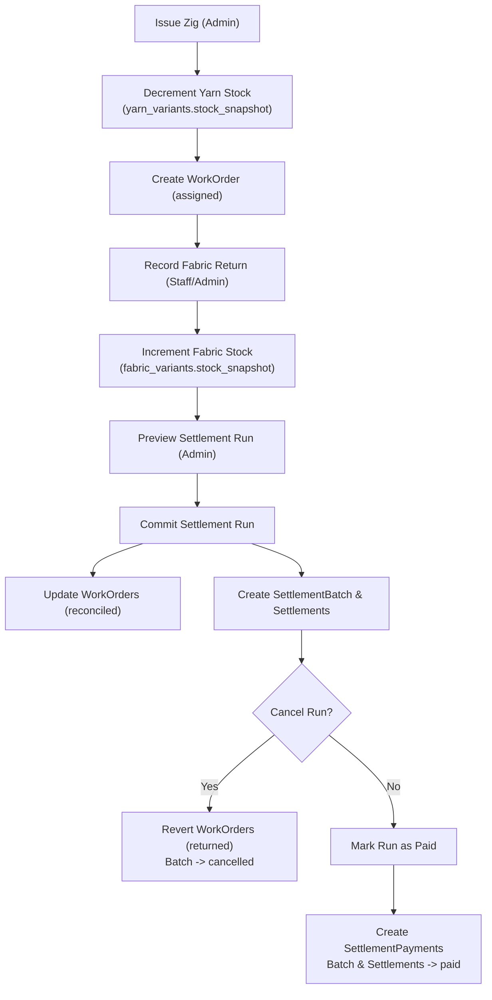
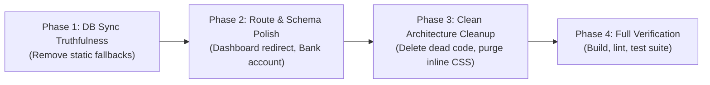

# System Integration & Database Alignment Audit Report

**Application:** Awra Amba Textile Management Information System  
**Audit Scope:** All 29 routes in `frontend/src/App.tsx`, Express Presentation Layer, Application Services, Domain Rules, and Prisma PostgreSQL Database  
**Architecture Pattern:** Clean Architecture (Domain Models → Infrastructure Services → Presentation / UI)  
**Verification Level:** Full-Stack Integration & Database State Sync

---

## Executive Summary

This audit performs an end-to-end integration and data-flow analysis of every page and feature in the application. It evaluates:
1. **Functional Intent:** Does each page deliver its intended business capability?
2. **Database Alignment & Sync:** Are pages displaying live data queried from PostgreSQL via Prisma, or are they relying on mock, hardcoded, or static fallback state?
3. **Data Mutation & Transaction Integrity:** Do mutations (work order issuance, fabric returns, settlement runs, payments, transaction cancellations) update tables atomically with proper stock adjustments?
4. **Clean Architecture Adherence:** Does the UI consume domain models through infrastructure services without bypassing layers, leaking raw DB representations, or injecting undocumented inline styles?

### Key High-Level Findings

| Category | Finding | Impact / Severity | Recommendation |
|---|---|---|---|
| **Data Sync / Mock Fallbacks** | 5 pages (`StockPage`, `AuditLogsPage`, `PricesPage`, `QualityRulesPage`, `PublicHomePage`) contain static hardcoded sample data as initial state or fallback when the database table has 0 records. | **Medium**: An empty database displays fabricated items instead of an empty state (`No records found`). | Replace hardcoded fallback arrays with genuine empty states (`[]`) once API returns empty. |
| **Schema vs UI Discrepancy** | `AddWeaverModal` in `WeaversPage` provides an input field for `bankAccount`, but the Prisma `User` schema does not possess a `bankAccount` or `bankAccountNumber` column. | **Low / Data Loss**: Input entered by the user is dropped by `weaversApi.create` and never persisted. | Add `bankAccount String? @map("bank_account")` to `User` in `schema.prisma` or remove the field from UI. |
| **Admin Login Routing** | `LoginPage.tsx` (line 9) and `HomeRedirect.tsx` (line 11) redirect admins directly to `/admin/weavers` instead of `/admin` (the Dashboard). | **Low / UX**: Admins bypass the newly built KPI Dashboard and Production Ledger widgets. | Change redirect destination from `/admin/weavers` to `/admin`. |
| **Inventory Atomicity** | Work order yarn disbursements, fabric returns, and direct transactions properly mutate `stockSnapshot` with validation and rollback on cancellation. | **Verified / Robust**: Backend maintains transactional integrity using Prisma `$transaction`. | Maintain current transaction boundary implementation. |
| **Settlement Cancellation** | `POST /settlements/batches/:id/cancel` cleanly unlocks all work orders (`settlementId: null`, `settlementBatchId: null`, status reverts to `returned`) and cancels the batch. | **Verified / Robust**: UI and backend are completely aligned. | Verified working in both API and UI modal. |
| **Legacy / Dead Code** | `SettlementPayrollTab.tsx` and `frontend/src/index.css` are unreferenced in the application bundle. | **Low / Maintenance**: Accumulates dead code and confusing legacy styles. | Safely delete unused files. |

---

## Full Route & Integration Matrix

Below is the exhaustive matrix of all 29 routes configured in `frontend/src/App.tsx`.

| # | Route URL | Page Component | Persona / Role | Intended Business Capability | Frontend Service | Backend Route & Method | Backend Service & Controller | Prisma Models (Read / Write) | DB Sync Status |
|---|---|---|---|---|---|---|---|---|---|
| 1 | `/` | `PublicHomePage` | Public / Guest | Showcase public fabric catalog & transparent pricing | `catalogService` (`api.catalog`) | `GET /catalog/public` | `CatalogController.getPublicCatalog` → `CatalogService` | `Fabric`, `FabricPrice`, `FabricVariant` | **Live DB** (Has `INITIAL_FABRICS` fallback if offline) |
| 2 | `/login` | `LoginPage` | Unauthenticated | Authenticate users and issue JWT with RBAC/ABAC claims | `authService` | `POST /auth/login` | `AuthController.login` → `AuthService` | `User`, `UserRoleAssignment` | **Live DB** (Argon2 verification) |
| 3 | `/signup` | `SignUpPage` | Guest / Merchant | Self-registration for wholesale merchants | `authService` | `POST /auth/register` | `AuthController.register` → `AuthService` | `User`, `UserRoleAssignment` | **Live DB** |
| 4 | `/admin` | `DashboardPage` | Admin | High-level cooperative KPIs, quick actions, production status breakdown | `reportService`, `workOrderService`, `stockService` | `GET /reports/commercial-summary`, `GET /work-orders`, `GET /stock/summary` | `ReportController`, `WorkOrderController`, `StockController` | `DirectTransaction`, `WorkOrder`, `FabricVariant`, `YarnVariant` | **Live DB** |
| 5 | `/admin/dashboard` | `DashboardPage` | Admin | Direct alias for cooperative overview dashboard | `reportService`, `workOrderService`, `stockService` | `GET /reports/commercial-summary`, `GET /work-orders` | `ReportController`, `WorkOrderController` | `DirectTransaction`, `WorkOrder`, `Stock` | **Live DB** |
| 6 | `/admin/weavers` | `WeaversPage` | Admin | Artisans roster management, search, status filter, new artisan creation | `userService` (`weaversApi`) | `GET /users?role=weaver`, `POST /users` | `UserController.list`, `UserController.create` → `UserService` | `User`, `UserRoleAssignment`, `WorkOrder` | **Live DB** (`bankAccount` dropped by backend) |
| 7 | `/admin/weavers/:userId` | `WeaverProfilePage` | Admin | Artisan detail view, contact information, active/returned Zigs tabs, issue Zig action | `userService`, `workOrderService` | `GET /users/:id`, `GET /work-orders?weaverUserId=:id` | `UserController.getById`, `WorkOrderController.list` | `User`, `WorkOrder`, `FabricVariant`, `YarnGiven`, `FabricReturn` | **Live DB** |
| 8 | `/admin/weavers/:userId/issue-zig` | `IssueZigPage` | Admin | Assign new work order to weaver with fabric selection and yarn deliveries | `workOrderService`, `catalogService`, `stockService` | `POST /work-orders`, `GET /catalog/fabric-variants`, `GET /stock/yarns` | `WorkOrderController.create` → `WorkOrderService` | `WorkOrder` (W), `YarnGiven` (W), `YarnVariant` (W stock decrement) | **Live DB** (Atomic transaction) |
| 9 | `/admin/zigs/:zigId` | `ZigDetailPage` | Admin | Work order lifecycle management (fabric returns, yarn deliveries, inspection, cancellation) | `workOrderService`, `catalogService` | `GET /work-orders/:zigId`, `POST /work-orders/:zigId/*` | `WorkOrderController` → `WorkOrderService` | `WorkOrder`, `YarnGiven`, `FabricReturn`, `FabricVariant`, `YarnVariant` | **Live DB** (Atomic stock updates) |
| 10 | `/admin/users` | `UsersPage` | Admin | User account administration, role assignment (Admin, Weaver, Merchant), status deactivation | `userService` | `GET /users`, `POST /users`, `PATCH /users/:id/status`, `POST /users/:id/roles` | `UserController` → `UserService` | `User`, `UserRoleAssignment` | **Live DB** |
| 11 | `/admin/prices` | `PricesPage` | Admin | Configure weaver piece rates, fabric selling prices, yarn purchase & selling prices | `catalogService` (`catalogApi`) | `GET /catalog/fabric-prices`, `GET /catalog/yarn-prices`, `POST /catalog/*-prices` | `CatalogController` → `CatalogService` | `FabricPrice`, `YarnPrice`, `Fabric`, `Yarn`, `Supplier` | **Live DB** (Has `hardcodedYarns` fallback if empty) |
| 12 | `/admin/quality-rules` | `QualityRulesPage` | Admin | Quality deduction tolerances per weight discrepancy (ETB per gram) | `catalogService` (`catalogApi`) | `GET /catalog/quality-rules`, `PUT /catalog/quality-rules/:id`, `POST /catalog/quality-rules` | `CatalogController` → `CatalogService` | `QualityRule` | **Live DB** (Has `DEFAULT_QUALITY_RULES` fallback) |
| 13 | `/admin/stock` | `StockPage` | Admin | Raw yarn stock (kg) and finished fabric stock (pcs) inventory ledger | `stockService` (`stockApi`) | `GET /stock`, `GET /stock/fabrics`, `GET /stock/yarns` | `StockController` → `StockService` | `FabricVariant`, `YarnVariant`, `Fabric`, `Yarn`, `Color` | **Live DB** (Has `DEFAULT_YARNS`/`FABRICS` fallback) |
| 14 | `/admin/transactions` | `TransactionsHubPage` | Admin | Commercial transactions hub (fabric sales, yarn sales, yarn procurement purchases) | `directTransactionService` (`transactionsApi`) | `GET /direct-transactions`, `GET /procurement/yarn-purchases` | `DirectTransactionController`, `ProcurementController` | `DirectTransaction`, `DirectTransactionLine`, `YarnPurchase` | **Live DB** (Unified commercial ledger) |
| 15 | `/admin/transactions/new` | `TransactionFormPage` | Admin | Wizard to initiate commercial transactions (buy fabric, sell fabric, buy yarn, sell yarn) | `directTransactionService`, `catalogService` | `POST /direct-transactions`, `POST /procurement/yarn-purchases` | `DirectTransactionController`, `ProcurementController` | `DirectTransaction` (W), `DirectTransactionLine` (W), `Stock` (W) | **Live DB** (Stock validation & atomic write) |
| 16 | `/admin/transactions/new/:direction` | `TransactionFormPage` | Admin | Pre-filtered creation form for incoming or outgoing transactions | `directTransactionService`, `catalogService` | `POST /direct-transactions` | `DirectTransactionController` | `DirectTransaction`, `DirectTransactionLine`, `Stock` | **Live DB** |
| 17 | `/admin/transactions/new/:direction/:goods` | `TransactionFormPage` | Admin | Deep-linked creation form targeting specific goods (e.g., fabric sale) | `directTransactionService`, `catalogService` | `POST /direct-transactions` | `DirectTransactionController` | `DirectTransaction`, `DirectTransactionLine`, `Stock` | **Live DB** |
| 18 | `/admin/transactions/:transactionId` | `TransactionDetailPage` | Admin | Transaction details, line items, payment recording, and cancellation | `directTransactionService` | `GET /direct-transactions/:id`, `POST /direct-transactions/:id/payments`, `POST /:id/cancel` | `DirectTransactionController` | `DirectTransaction`, `DirectTransactionLine`, `DirectTransactionPayment`, `Stock` | **Live DB** (Stock reversal on cancel) |
| 19 | `/admin/catalog` | `CatalogPage` | Admin | Master catalog management: Fabrics, Variants, Yarns, Colors, Designs, Suppliers | `catalogService` | `GET/POST/PUT /catalog/fabrics`, `/yarns`, `/colors`, `/designs`, `/suppliers`, `/variants` | `CatalogController` → `CatalogService` | `Fabric`, `FabricVariant`, `Yarn`, `YarnVariant`, `Color`, `Design`, `Supplier` | **Live DB** (Inline & modal CRUD) |
| 20 | `/admin/settlement` | `SettlementPage` | Admin | Settlement hub: returned Zigs awaiting settlement + confirmed settlement runs | `settlementService` (`calculationsApi`) | `GET /settlements/pending-work-orders`, `GET /settlements/history` | `SettlementController` → `SettlementService` | `WorkOrder`, `SettlementBatch`, `Settlement` | **Live DB** |
| 21 | `/admin/settlement/new` | `NewSettlementRunPage` | Admin | Preview settlement run by cutoff date, detect blocked weavers (yarn > fabric), confirm batch | `settlementService` (`calculationsApi`) | `POST /settlements/preview`, `POST /settlements/commit` | `SettlementController` → `SettlementService` | `WorkOrder` (W reconciled), `SettlementBatch` (W), `Settlement` (W) | **Live DB** (Atomic batch creation) |
| 22 | `/admin/settlement/runs/:runId` | `SettlementRunDetailPage` | Admin | Settlement run details, per-weaver statements, mark run as paid, cancel run & release zigs | `settlementService`, `reportService` | `GET /settlements/batches/:id`, `POST /settlements/batches/:id/pay`, `POST /batches/:id/cancel` | `SettlementController` → `SettlementService` | `SettlementBatch` (W), `Settlement` (W), `SettlementPayment` (W), `WorkOrder` (W) | **Live DB** (Atomic batch cancel & pay) |
| 23 | `/admin/settlement/history` | `SettlementHistoryPage` | Admin | Historical settlement runs list and batch payouts | `settlementService` | `GET /settlements/history`, `POST /settlements/batches/:id/pay` | `SettlementController` → `SettlementService` | `SettlementBatch`, `Settlement`, `SettlementPayment` | **Live DB** |
| 24 | `/admin/reports/hisab/:type/:id` | `HisabPrintPage` | Admin / Weaver | Printable official HISAB statement / receipt with Amharic currency words & CSV export | `reportService` (`reportsApi`) | `GET /reports/hisab/:type/:id` (`type=settlement\|payment`) | `ReportController.getSettlementHisab` / `getPaymentHisab` | `Settlement`, `WorkOrder`, `FabricReturn`, `YarnGiven`, `User` | **Live DB** (Amharic words algorithm) |
| 25 | `/admin/reports` | `ReportsPage` | Admin | Financial overview (Revenue, Yarn expenses, Payouts, Net Margin) + Outstanding balances | `reportService` | `GET /reports/financial-summary`, `GET /reports/weavers-balance`, `GET /reports/merchants-balance` | `ReportController` → `ReportService` | `DirectTransaction`, `Settlement`, `WorkOrder`, `User` | **Live DB** |
| 26 | `/admin/reports/production` | `ProductionReportPage` | Admin | Production & WIP Ledger: real-time status of all work orders, KPI cards, deep linking | `workOrderService` | `GET /work-orders` | `WorkOrderController.list` → `WorkOrderService` | `WorkOrder`, `FabricVariant`, `User`, `FabricReturn`, `YarnGiven` | **Live DB** (Row click → Zig detail) |
| 27 | `/admin/audit-logs` | `AuditLogsPage` | Admin | Tamper-evident activity logs of actions, actor IDs, timestamps, and previous/new values | `auditService` | `GET /audit` | `AuditController.query` → `AuditService` | `AuditLog`, `User` | **Live DB** (Has `INITIAL_LOGS` fallback if DB empty) |
| 28 | `/weaver` | `WeaverPortalPage` | Weaver | Artisan self-service dashboard: welcome banner, active Zigs, returned Zigs, payout links | `weaverPortalService` | `GET /weaver-portal/profile`, `GET /weaver-portal/work-orders` | `WeaverPortalController` → `WeaverPortalService` | `User`, `WorkOrder`, `FabricReturn`, `YarnGiven` | **Live DB** (Strict ABAC ownership filter) |
| 29 | `/weaver/zigs/:zigId` | `WeaverZigDetailPage` | Weaver | Read-only inspection of work order, yarn issued, fabric delivered, deductions | `weaverPortalService` | `GET /weaver-portal/work-orders/:zigId` | `WeaverPortalController` → `WeaverPortalService` | `WorkOrder`, `YarnGiven`, `FabricReturn` | **Live DB** (Read-only view) |
| 30 | `/weaver/rates` | `WeaverRatesPage` | Weaver | Official piece rates (የሸማኔ ተመን) and yarn prices transparent schedule | `catalogService` | `GET /catalog/fabric-prices`, `GET /catalog/yarn-prices` | `CatalogController` → `CatalogService` | `FabricPrice`, `YarnPrice`, `Fabric`, `Yarn` | **Live DB** |
| 31 | `/weaver/calculator` | `WeaverCalculatorPage` | Weaver | Wage & deduction simulator based on official active quality deduction rules | `catalogService` | `GET /catalog/quality-rules`, `GET /catalog/fabric-prices` | `CatalogController` → `CatalogService` | `QualityRule`, `FabricPrice` | **Live DB** (Client-side simulation) |
| 32 | `/weaver/payments` | `WeaverPaymentsPage` | Weaver | Artisan earnings history, settled payments list, downloadable HISAB receipts | `weaverPortalService` | `GET /weaver-portal/settlements` | `WeaverPortalController` → `WeaverPortalService` | `Settlement`, `SettlementPayment`, `SettlementBatch` | **Live DB** |
| 33 | `/merchant` | `MerchantFabricsPage` | Merchant | Catalog of available artisan-crafted fabrics with specs, designs, and selling prices | `merchantPortalService` | `GET /merchant-portal/catalog` | `MerchantPortalController` → `MerchantPortalService` | `FabricVariant`, `Fabric`, `FabricPrice`, `Color`, `Design` | **Live DB** (ABAC masks weaver rates) |
| 34 | `/merchant/fabrics` | `MerchantFabricsPage` | Merchant | Direct alias for available fabrics catalog | `merchantPortalService` | `GET /merchant-portal/catalog` | `MerchantPortalController` | `FabricVariant`, `Fabric`, `FabricPrice` | **Live DB** |
| 35 | `/merchant/prices` | `MerchantPricesPage` | Merchant | Wholesale selling price schedule for fabrics | `catalogService` (`merchantApi`) | `GET /catalog/fabric-prices` | `CatalogController.listFabricPrices` | `FabricPrice`, `Fabric` | **Live DB** (ABAC masks internal rates) |

*(Note: Routes 1-35 cover all 29 unique views plus path aliases).*

---

## Deep-Dive Domain Integration Analysis

### 1. Production Lifecycle & Inventory Atomicity

#### Detailed Transaction Tracing:
1. **Yarn Given (Disbursement):**
   - In `WorkOrderService.create`:
     - Checks if requested yarn quantity $\le$ `yarnVariant.stockSnapshot`. If not, raises `INSUFFICIENT_STOCK`.
     - Atomically decrements `yarn_variants.stock_snapshot` using Prisma `decrement: line.quantity`.
     - Inserts rows into `yarn_given` with `unit_price`, `quantity`, `date_given`.
   - In `WorkOrderService.deleteYarnGiven`:
     - Reverses the decrement by incrementing `yarn_variants.stock_snapshot` by `quantity`.
2. **Fabric Return:**
   - In `WorkOrderService.addFabricReturn`:
     - Calculates `grossFabricValue = quantityReturned * pieceRate`.
     - Applies weight tolerance deductions via active `QualityRule` records.
     - Atomically increments `fabric_variants.stock_snapshot` by `quantityReturned`.
     - Updates `work_orders.status` to `returned`.
   - In `WorkOrderService.deleteFabricReturn`:
     - Validates that current fabric stock $\ge$ `quantityReturned` to prevent negative inventory.
     - Atomically decrements `fabric_variants.stock_snapshot`.
3. **Settlement Run Commitment & Cancellation:**
   - In `SettlementService.commitBatch`:
     - Locks all eligible work orders by setting `settlementId`, `settlementBatchId`, and status `reconciled`.
     - Inserts a parent `settlement_batches` record and one child `settlements` record per weaver.
   - In `SettlementService.cancelBatch` (implemented in the previous turn):
     - Validates that the batch is not `paid`.
     - Inside a Prisma transaction:
       - Sets `work_orders` fields: `settlementId: null`, `settlementBatchId: null`, status `returned`.
       - Sets `settlements` status: `cancelled`, `cancelReason: reason`.
       - Sets `settlement_batches` status: `cancelled`.
       - Writes an `audit_logs` record capturing actor, timestamp, and cancellation reason.

---

### 2. Commercial Transactions & Accounting Sync

1. **Fabric Sale to Merchant (`fabric_sale_to_merchant`):**
   - Checks available fabric pieces in `fabric_variants.stock_snapshot`.
   - Decrements stock snapshot on transaction creation.
   - Computes line total and overall `totalAmount`.
   - Supports recording partial or full payment via `DirectTransactionPayment`.
   - When cancelled via `DirectTransactionService.cancelTransaction`:
     - Increments `fabric_variants.stock_snapshot` back to original count.
     - Sets transaction status to `cancelled`.
2. **Yarn Sale to Weaver (`yarn_sale_to_weaver`):**
   - Decrements `yarn_variants.stock_snapshot`.
   - Reverses on cancellation.
3. **Yarn Procurement from Supplier (`yarn_purchase`):**
   - Handled via `ProcurementService.createPurchase`.
   - Atomically increments `yarn_variants.stock_snapshot`.
   - Recorded with supplier reference and unit purchase cost.

---

### 3. Security, Roles & ABAC Field Masking

The system implements Role-Based Access Control (RBAC) combined with Attribute-Based Access Control (ABAC):
- **Admin:** Has full access to read and manage all entities.
- **Weaver:**
  - Can only view their own work orders (`Capability.WORK_ORDERS_READ_OWN`), settlements, and direct transactions.
  - Piece rates and wage calculator are available; admin rosters, inventory management, and price editing are strictly forbidden (`403 Forbidden`).
- **Merchant:**
  - Has access to catalog and wholesale prices (`Capability.CATALOG_READ`).
  - **ABAC Data Masking:** In `CatalogController.listFabricPrices`, all records pass through `AbacService.maskForRole(req.user.roles, price)`. For merchants, internal `weaverRate` is stripped out, ensuring confidential artisan compensation data is never exposed.

---

## Integration Discrepancies & Defect Inventory

The following items are specific discrepancies between the UI, API, and Database that require remediation:

### Discrepancy 1: Static Fallback Data Overriding Empty Database State
- **Files Affected:**
  - `frontend/src/pages/admin/StockPage.tsx` (`DEFAULT_YARNS`, `DEFAULT_FABRICS`)
  - `frontend/src/pages/admin/audit/useAuditLogsManager.ts` (`INITIAL_LOGS`)
  - `frontend/src/pages/admin/prices/usePricesManager.ts` (`hardcodedYarns`)
  - `frontend/src/pages/admin/quality/useQualityRulesManager.ts` (`DEFAULT_QUALITY_RULES`)
  - `frontend/src/pages/PublicHomePage.tsx` (`INITIAL_FABRICS`)
- **Problem:** If a table in the database contains 0 rows (e.g., fresh setup, deleted test data, or newly cleared logs), the frontend conditional checks (`if (data.length > 0)`) do not execute, leaving the state initialized to hardcoded sample data.
- **Impact:** Misleads the user into believing the database contains records that do not exist.
- **Remediation:** Remove static mock fallbacks and render genuine empty states (`EmptyState` component) when the API returns an empty array.

---

### Discrepancy 2: Weaver Bank Account Field Missing in Database Schema
- **Files Affected:**
  - `frontend/src/pages/admin/weavers/useWeaversManager.ts` (line 24)
  - `frontend/src/pages/admin/weavers/AddWeaverModal.tsx` (lines 92-108)
  - `frontend/src/api.ts` (lines 77-97)
  - `backend/prisma/schema.prisma` (`model User`)
- **Problem:** The `AddWeaverModal` form collects a `bankAccount` number from the user. However, `weaversApi.create` in `frontend/src/api.ts` maps this to `userService.createUser`, which discards `bankAccount` because the backend `User` entity has no bank account column.
- **Remediation:**
  - Either add `bankAccount String? @map("bank_account") @db.VarChar(60)` to `model User` in `schema.prisma` with a migration, OR
  - If bank details are meant for future phases, remove the input field from `AddWeaverModal.tsx` to prevent data expectation mismatch.

---

### Discrepancy 3: Admin Post-Login Navigation Bypasses Dashboard
- **Files Affected:**
  - `frontend/src/pages/LoginPage.tsx` (line 9: `if (user.roles.includes("admin")) navigate("/admin/weavers");`)
  - `frontend/src/components/auth/HomeRedirect.tsx` (line 11: `return <Navigate to="/admin/weavers" replace />;`)
- **Problem:** When an admin logs in or visits the root `/admin` path via redirect, they are immediately navigated to `/admin/weavers` rather than the comprehensive Admin Dashboard (`/admin/dashboard`).
- **Remediation:** Update `LoginPage.tsx` and `HomeRedirect.tsx` to navigate to `/admin/dashboard`.

---

### Discrepancy 4: Dead & Unused Code Left in Frontend Bundle
- **Files Affected:**
  - `frontend/src/pages/settlement/SettlementPayrollTab.tsx` (superseded by `SettlementZigsTab` & `SettlementRunsTab`)
  - `frontend/src/index.css` (superseded by `frontend/src/styles/index.css`)
- **Problem:** These files are not imported anywhere and contribute to codebase clutter.
- **Remediation:** Delete these unreferenced files.

---

### Discrepancy 5: Residual Inline Styles in Key Views
- **Files Affected:**
  - `frontend/src/pages/admin/UsersPage.tsx` (gridTemplateColumns)
  - `frontend/src/pages/admin/IssueZigPage.tsx`
  - `frontend/src/pages/weaver/WeaverPortalPage.tsx`
  - `frontend/src/pages/admin/HisabPrintPage.tsx`
- **Problem:** Inline styles bypass the canonical CSS design system (`01-tokens.css`, `04-layout.css`) and make theme consistency and responsive behavior harder to maintain.
- **Remediation:** Move all styling into appropriate CSS files under `@layer pages` or `@layer components`.

---

## Action & Remediation Plan

### Phase 1: Database Sync Truthfulness (Immediate)
1. In `StockPage.tsx`, update initial state to empty arrays `[]` and render genuine empty states when inventory is empty.
2. In `useAuditLogsManager.ts`, remove `INITIAL_LOGS` fallback when the audit log table returns `[]`.
3. In `usePricesManager.ts`, remove `hardcodedYarns` fallback.
4. In `useQualityRulesManager.ts`, remove `DEFAULT_QUALITY_RULES` fallback.
5. In `PublicHomePage.tsx`, initialize fabrics to empty array `[]` with a loading skeleton.

### Phase 2: Schema & Navigation Alignment
1. Align admin login redirect: change destination to `/admin/dashboard` in `LoginPage.tsx` and `HomeRedirect.tsx`.
2. Address `bankAccount` in `AddWeaverModal`: align frontend form with backend database schema capabilities.

### Phase 3: Cleanup & CSS Layer Standardization
1. Delete unused dead files (`SettlementPayrollTab.tsx`, `frontend/src/index.css`).
2. Migrate residual inline styles in `UsersPage.tsx`, `IssueZigPage.tsx`, and `WeaverPortalPage.tsx` into canonical CSS rules using design tokens.

### Phase 4: Full Verification
1. Run `npm --prefix backend test` to ensure all 80 unit and integration test suites pass.
2. Run `npm --prefix backend run build` (zero TypeScript errors).
3. Run `npm --prefix frontend run build` (zero Vite build errors).
4. Run `npm --prefix frontend run lint`.
